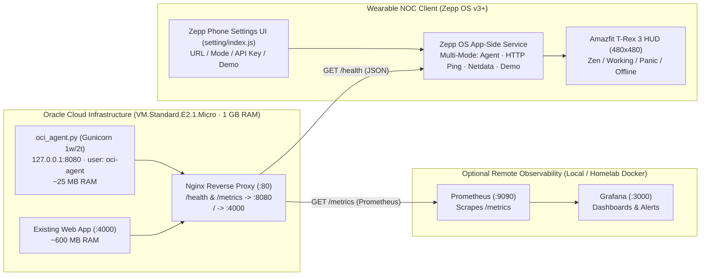

# SysAdmin Pet — Lightweight OCI Linux Telemetry Agent & Smartwatch NOC HUD

A real-time, ultra-lightweight Linux monitoring stack built for resource-constrained cloud servers (**Oracle Cloud Infrastructure `VM.Standard.E2.1.Micro` — 1 GB RAM**). It exposes real-time host telemetry (`CPU`, `RAM`, `Swap`, `Disk`, `Network RX/TX`, `Uptime`, and `Top Memory Process`) via a hardened `systemd` + **Gunicorn** + **Nginx** reverse-proxy pipeline to both an **Amazfit T-Rex 3 (Zepp OS)** animated smartwatch HUD and an optional remote **Prometheus + Grafana** observability stack.

---

## Architecture



---

## Key Engineering & Capacity Decisions

### 1. Designed for a 1 GB RAM Micro VM (FinOps / Resource Awareness)
The target OCI Always Free instance (`VM.Standard.E2.1.Micro`) has only **1 GB of RAM**, with **~600+ MB** already consumed by an existing web application on port `4000`.
- Rather than installing heavy monitoring stacks directly on the VM (which would trigger Linux OOM Killer events), the on-host agent runs a **single-worker Gunicorn WSGI process** (`~25–30 MB RSS`) backed by `psutil`.
- Prometheus and Grafana live in `observability/docker-compose.yml` to run **off-host** (on a workstation or monitoring node), scraping the zero-overhead `/metrics` endpoint remotely.

### 2. Security Hardening Applied
- **Least Privilege (`systemd`):** Runs under a dedicated locked system user (`oci-agent`, `/usr/sbin/nologin`) instead of `root`, with `NoNewPrivileges=true`, `PrivateTmp=true`, `ProtectSystem=strict`, and `ProtectHome=true`.
- **Zero Direct Backend Exposure:** Gunicorn binds strictly to `127.0.0.1:8080` and port `8080` is blocked from external `iptables` ingress. All external traffic passes through **Nginx** on port `80`.
- **Optional API Key Authentication:** Set `SYSADMIN_PET_API_KEY` (via `.env.local` / `app-side/config.js`) to require an `X-API-Key` header on `/health` and `/metrics`.
- **No Secrets in Git:** Real server IPs and SSH paths are kept in gitignored `.env.local` and `app-side/config.js`.

### 3. Zepp App Store Multi-Mode Support (`setting/index.js`)
To allow any user downloading **SysAdmin Pet** from the Zepp App Store to use it immediately without editing code or compiling locally, the app includes a native **Zepp Mobile Settings UI** (`setting/index.js`) supporting 4 telemetry modes:
1. **Auto-Detect / Full Linux Agent (`/health`):** Connects to `oci_agent.py` (or the 1-line installer `oci-agent/install-agent.sh`) for full `CPU`, `RAM`, `Swap`, `Disk`, `Network RX/TX`, `Uptime`, and `Top Memory Process` telemetry.
2. **Zero-Install Website / API Ping (`http_ping`):** Works with **any public HTTP/HTTPS URL** without installing anything on the server. Measures HTTP response status and RTT latency (`ms`), dynamically driving the Tamagotchi state (`<250ms` Zen, `250–800ms` Working, `>800ms` Panic, timeout/5xx Offline).
3. **Native Netdata Mode (`netdata`):** Connects directly to an existing Netdata instance (`/api/v1/data?chart=system.cpu`).
4. **Interactive Store Demo Mode (`demo`):** Automatically activates when no server URL is configured yet, cycling through realistic server workloads (`Zen → Working → Panic → Zen`) so first-time users and Zepp Store reviewers see the animated HUD working out-of-the-box.

---

## Quick Start

### Option A: 1-Line Standalone Linux Agent (For Any VPS User)
If you installed **SysAdmin Pet** from the Zepp App Store and want full Linux telemetry on any Ubuntu/Debian VPS without cloning the full repository:
```bash
curl -fsSL https://raw.githubusercontent.com/Abeners2/sysadmin-pet/main/oci-agent/install-agent.sh | sudo bash
```
Then open the **Zepp Mobile App → SysAdmin Pet → Settings (⚙️)** and paste your server URL (`http://YOUR_SERVER_IP:8080/health`).

### Option B: Developer Setup & OCI Deployment
#### 1. Configure Local Credentials (Gitignored)
```powershell
Copy-Item .env.example .env.local
Copy-Item app-side/config.example.js app-side/config.js
# Edit .env.local and app-side/config.js with your OCI VM IP and optional API key
```

### 2. One-Command Automated Deploy to OCI
```powershell
.\deploy-oci.ps1
```
This packages the project, transfers it via `scp`, runs `infra/remote-setup.sh` over `ssh` (provisioning the non-root `systemd` service, Gunicorn, Nginx proxy, and animated sprites), and syncs the generated assets back locally.

### 3. Optional Remote Prometheus + Grafana Stack (Run Locally, Not on the 1 GB VM)
```bash
# Edit observability/prometheus.yml with your OCI VM IP
cd observability
docker compose up -d
# Prometheus: http://localhost:9090 | Grafana: http://localhost:3000 (admin/admin)
```

---

## Linux Troubleshooting & RCA Playbook

Common operational checks used when investigating incidents on the OCI host:

| Symptom | Diagnostic Commands | Root Cause / Resolution |
| :--- | :--- | :--- |
| **`/health` returns HTTP `502 Bad Gateway`** | `sudo systemctl status oci-tamagotchi`<br>`sudo journalctl -u oci-tamagotchi -n 50 --no-pager` | Gunicorn agent stopped or crashed. Inspect Python traceback in `journalctl`, verify `venv` dependencies, and restart with `sudo systemctl restart oci-tamagotchi`. |
| **Connection timeout from Smartwatch / External** | `sudo ss -tulpn \| grep -E ':80\|:8080'`<br>`sudo iptables -L INPUT -n --line-numbers`<br>`curl -i http://127.0.0.1/health` | Check if Nginx is listening on `:80`, verify OCI Security List / NSG ingress rules for TCP `80`, and confirm local `iptables` allows HTTP traffic. |
| **High RAM / Swap spike or unexpected restarts** | `free -h`<br>`ps aux --sort=-%mem \| head -n 10`<br>`dmesg -T \| grep -iE 'oom\|killed process'` | On a 1 GB VM, heavy workloads on `:4000` can trigger OOM Killer. Verify swap usage, identify top memory consumer, and cap worker counts. |
| **Nginx reload fails after config change** | `sudo nginx -t`<br>`sudo tail -n 30 /var/log/nginx/error.log` | Syntax error in `/etc/nginx/sites-available/default`. Validate with `nginx -t` before reloading. |
